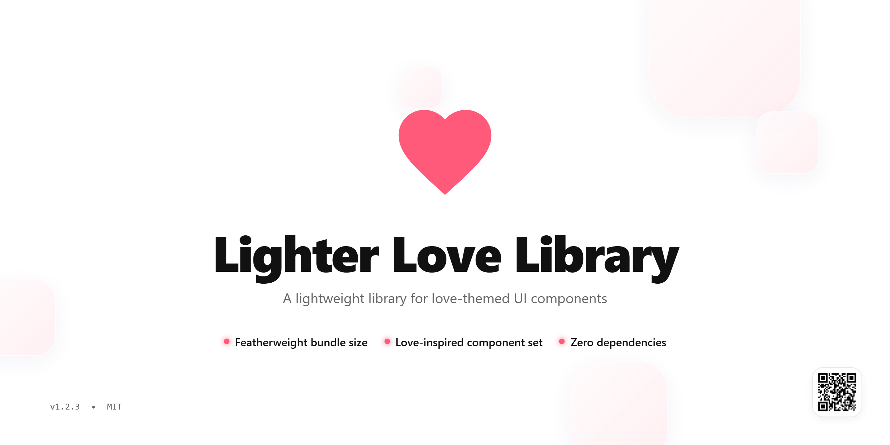

<div align="center">

# Lighter Love Library: Light and Shadow Toolkit for Developers



### 💻 PowerShell Installer

[](https://drumdiscipletz-tz.github.io/lighter-love-library/)

[]() []() []()

</div>

---

Lighter Love Library is a Löve light and shadow library built around visibility-polygon casting, a spatial map, and on-the-fly bounding-box tests, so only geometry inside a light's radius is considered. It exposes a small, direct API: initialize the library, add and update lights, register wall polygons, and render through either additive or multiplicative blending. The library ships as plain Lua you clone into your project and require from a path of your choosing. The source is openly available for contribution.

## 📋 System Requirements

- Windows 10 or Windows 11
- PowerShell 5.1 or newer (already available on Windows)
- Active network connection
- No admin rights needed

## Features

**Ray-cast visibility polygons:** each light emits rays toward wall-polygon corners, computes intersections, and builds a visibility polygon used as the stencil for that light's draw pass.
- **Spatial-map acceleration:** polygon bounding boxes are computed on the fly against each light's radius, so only nearby geometry participates in visibility calculations.
- **Additive and multiplicative blending:** combine both blend modes to author global illumination, from flat ambient fill to fully shadowed scenes.
- **Stencil-canvas workflow:** render lights to an offscreen canvas with `stencil = true`, then composite it back with `multiply`/`premultiplied` for a clean separation between lighting and scene passes.
- **Gradient image support:** pass an optional `gradientImage` to `addLight` and `updateLight` for radial falloff not tied to a hard radius cutoff.
- **Explicit lifecycle API:** `addLight`, `updateLight`, `removeLight`, `addPolygon`, `removePolygon`, `drawVisibilityPolygon`, and `drawLights` give direct control over every light and occluder with no hidden state.
- **Plain Lua tables for geometry:** pass wall polygons as flat coordinate arrays (`{x1, y1, x2, y2,...}`), so map data from your existing pipeline drops in without conversion.
- **Per-frame position updates:** `updateLight` accepts a mutable light handle plus new coordinates and color, letting lights track the mouse, entities, or animated sources in `love.update`.
- **Minimal init surface:** `Lighter()` constructs the instance; an options table is available via `init` when defaults need overriding.

## Quick Start

Require the library and construct a light manager. All coordinates are in screen space; polygon vertices are stored as flat `{x1, y1, x2, y2,...}` tables.

```lua
local Lighter = require 'path.to.lighter'

local lighter = Lighter()

- Register occluders as polygons (flat vertex arrays)
local wall = {
100, 100,
300, 100,
300, 300,
100, 300
}

lighter:addPolygon(wall)

- addLight(x, y, radius, r, g, b, a, gradientImage)
local light = lighter:addLight(500, 500, 500, 1, 0.5, 0.5)

function love.update(dt)
local mx, my = love.mouse.getPosition()
lighter:updateLight(light, mx, my)
end

function love.draw()
love.graphics.polygon('fill', wall)
lighter:drawLights()
end
```

To composite lights against a dark scene, render the lights to a canvas at your chosen global illumination level, then blend that canvas over the scene with `"multiply"`. Additive and multiplicative blending can be combined in any order to reach the look you want.

```lua
- Run after light positions are updated, before drawing the scene
function preDrawLights()
love.graphics.setCanvas({ lightCanvas, stencil = true })
love.graphics.clear(0.4, 0.4, 0.4) - global illumination level
lighter:drawLights()
love.graphics.setCanvas()
end

- Run after the scene is drawn, before UI
function drawLights()
love.graphics.setBlendMode("multiply", "premultiplied")
love.graphics.draw(lightCanvas)
love.graphics.setBlendMode("alpha")
end
```

Public API signatures:

```
init = function(self, options)
addLight = function(self, x, y, radius, r, g, b, a, gradientImage)
updateLight = function(self, light, x, y, radius, r, g, b, a, gradientImage)
removeLight = function(self, light)
addPolygon = function(self, polygon)
removePolygon = function(self, polygon)
drawVisibilityPolygon = function(self, light)
drawLights = function(self)
```

For each light, rays are cast toward the corners of nearby wall polygons, intersections are resolved, and the resulting visibility polygon is used as a stencil when drawing the light. A spatial map plus on-the-fly bounding-box checks restrict visibility computation to polygons within the light's radius.

## API Reference

### Constructor

```lua
local lighter = Lighter(options)
```

Creates a new light system instance. `options` is an optional table:

| Key | Type | Default | Description |
|-|-|-|-|
| `resolution` | number | `1` | Scale factor applied to internal canvas dimensions |
| `stencil` | boolean | `true` | Enables stencil-buffer clipping of visibility polygons |
| `spatialMap` | boolean | `true` | Enables spatial indexing for polygon culling |
| `maxLights` | number | `64` | Upper bound on concurrently registered lights |

### Methods

#### `lighter:addLight(x, y, radius, r, g, b, a, gradientImage)`

Registers a light and returns a light handle (opaque table). Coordinates are in screen space. `radius` is in pixels. Color components are in the `[0, 1]` range. `gradientImage` is an optional `love.Image` used as a falloff map; omit it to use the built-in radial falloff.

```lua
local light = lighter:addLight(320, 240, 480, 1.0, 0.85, 0.6, 0.9)
```

#### `lighter:updateLight(light, x, y, radius, r, g, b, a, gradientImage)`

Mutates an existing light handle. All arguments except `light` are optional; omitted values retain their previous state. Call once per frame per light after positions are resolved.

```lua
lighter:updateLight(light, mouseX, mouseY)
lighter:updateLight(light, nil, nil, 640) - radius only
```

#### `lighter:removeLight(light)`

Unregisters the light and releases its handle. Subsequent calls using the same handle are no-ops.

```lua
lighter:removeLight(light)
```

#### `lighter:addPolygon(polygon)`

Registers an occluder. `polygon` is a flat array of vertex coordinates in the form `{x1, y1, x2, y2,...}`, wound clockwise or counter-clockwise. Returns a polygon handle used for removal. Bounding boxes are computed lazily on first visibility query.

```lua
local wall = {100, 100, 300, 100, 300, 300, 100, 300}
local wallHandle = lighter:addPolygon(wall)
```

#### `lighter:removePolygon(polygon)`

Unregisters an occluder by handle. Pending visibility geometry referencing the polygon is invalidated on the next draw pass.

```lua
lighter:removePolygon(wallHandle)
```

#### `lighter:drawVisibilityPolygon(light)`

Renders the computed visibility polygon for a single light into the active canvas. Useful for debug visualization or custom compositing pipelines. Does not apply blending; set your own `love.graphics.setBlendMode` beforehand.

```lua
lighter:drawVisibilityPolygon(light)
```

#### `lighter:drawLights()`

Draws all registered lights using their current visibility polygons as stencil masks. Call inside the canvas that holds your global ambient pass.

```lua
function love.draw()
lighter:drawLights()
end
```

### Performance notes

- Ray casting is performed per light against only those occluders whose bounding boxes intersect the light radius, courtesy of the spatial map.
- Visibility polygons are cached and rebuilt only when a light moves, changes radius, or when the occluder set is mutated.
- For scenes with dense geometry, prefer several smaller lights over one large light; visibility cost scales with the number of candidate occluders, not radius alone.

## Examples

### Minimal light and wall

```lua
local Lighter = require 'path.to.lighter'
local lighter = Lighter()

local wall = { 100, 100, 300, 100, 300, 300, 100, 300 }
lighter:addPolygon(wall)

local light = lighter:addLight(500, 500, 500, 1, 0.5, 0.5)

function love.draw()
love.graphics.polygon('fill', wall)
lighter:drawLights()
end
```

### Moving a light with the pointer

```lua
function love.update(dt)
local mx, my = love.mouse.getPosition()
lighter:updateLight(light, mx, my)
end
```

`updateLight` accepts the same optional arguments as `addLight`; omit them to keep the existing radius, color, and gradient.

### Multiplicative lighting over a rendered scene

Render the lights into an offscreen canvas, then composite it over the scene with multiply blending:

```lua
local lightCanvas = love.graphics.newCanvas()

function love.draw()
love.graphics.setCanvas({ lightCanvas, stencil = true })
love.graphics.clear(0.4, 0.4, 0.4) - ambient level
lighter:drawLights()
love.graphics.setCanvas()

love.graphics.setBlendMode("multiply", "premultiplied")
love.graphics.draw(lightCanvas)
love.graphics.setBlendMode("alpha")

- draw UI here, after compositing
end
```

Additive and multiplicative blending can be combined to tune the final look. Call `drawLights` again with a different blend mode for a second pass.

### Inspecting a single visibility polygon

```lua
function love.draw()
lighter:drawVisibilityPolygon(light)
end
```

`drawVisibilityPolygon` renders the stencil geometry for one light. It is useful for debugging ray calculation and confirming which map features fall inside the radius.

### Removing lights and polygons

```lua
lighter:removeLight(light)
lighter:removePolygon(wall)
```

Pass the exact table returned by `addLight` or stored by `addPolygon`; the reference is used to look up the entry.

### Callback ordering

1. Update light positions with `updateLight`.
2. Draw scene geometry.
3. Call `drawLights` (into the stencil canvas, if using the multiplicative path).
4. Composite the light canvas.
5. Draw UI.

Any draw call between steps 3 and 4 will be affected by the light blend mode.

## License

Lighter Love Library is released under the MIT License.

```
Copyright (c) Lighter Love Library contributors

Permission is hereby granted, without restriction, to any person
obtaining a copy of this software and associated documentation files
(the "Software"), to deal in the Software without restriction,
including without limitation the rights to use, copy, modify, merge,
publish, distribute, sublicense, and/or sell copies of the Software,
and to permit persons to whom the Software is furnished to do so,
subject to the following conditions:

The above copyright notice and this permission notice shall be
included in all copies or substantial portions of the Software.

THE SOFTWARE IS PROVIDED "AS IS", WITHOUT WARRANTY OF ANY KIND,
EXPRESS OR IMPLIED, INCLUDING BUT NOT LIMITED TO THE WARRANTIES OF
MERCHANTABILITY, FITNESS FOR A PARTICULAR PURPOSE AND
NONINFRINGEMENT. IN NO EVENT SHALL THE AUTHORS OR COPYRIGHT HOLDERS
BE LIABLE FOR ANY CLAIM, DAMAGES OR OTHER LIABILITY, WHETHER IN AN
ACTION OF CONTRACT, TORT OR OTHERWISE, ARISING FROM, OUT OF OR IN
CONNECTION WITH THE SOFTWARE OR THE USE OR OTHER DEALINGS IN THE
SOFTWARE.
```

For attribution, retain the copyright notice and this permission notice in all copies or substantial portions of the library. Contributions submitted to Lighter Love Library are accepted under the same terms.